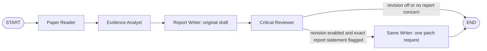

# Paper Research Team — Research Desk

Examine one English research-paper PDF: explain the proposal, inspect experimental
evidence, and read a separate critical review with exact source references.
The motivation was reassuring LLM feedback that missed ambiguities later raised by
human reviewers. That experience motivates the critic; it does not demonstrate
better accuracy than a single model.

## Run locally

Python 3.12 is recorded in `.python-version`; dependencies are pinned in
`requirements.txt`. No new dependency was added for these upgrades.

```sh
python3 -m venv .venv
source .venv/bin/activate
python -m pip install -r requirements.txt
cp .env.example .env  # Only for a fresh setup; preserve an existing .env.
# Set GROQ_API_KEY and a long random RESEARCH_ACCESS_TOKEN in .env.
uvicorn app:app --reload --host 127.0.0.1 --port 8000
# Alternative: python app.py
```

Open http://127.0.0.1:8000. Enter the access token if requested, upload one PDF,
enter a question, optionally enable targeted revision, and start. Download the
Markdown report or inspect evidence, team notes and per-run metrics.

## Workflow



There are **four roles**, not a fifth supervisor. Reader explains the problem and
proposal; Analyst checks datasets, baselines, metrics and reported evidence. Writer
combines their structured findings. Reviewer challenges the paper and the draft.
Findings travel directly through typed LangGraph state.

Optional revision changes only exact draft statements flagged by the Reviewer.
Python rejects patches to other statements, invented evidence and duplicate indices.
The original draft and review remain visible; the separate revision receives **no
second review**. A failed revision preserves both original results and marks the run
incomplete. No accuracy improvement from revision or model diversity has been measured.

## Retrieval, PDF extraction and source limits

`search_paper(query)` ranks exact passages using standard-library **BM25** with term
frequency, inverse document frequency and passage-length normalization. It returns
at most four passages; `get_evidence(id)` returns one exact stored passage. Tools
have explicit argument schemas and fixed Python dispatch. BM25 remains lexical:
it can miss paraphrases such as “dataset” versus “ImageNet.” There are no embeddings,
vector database, external literature searches or global novelty claims.

pypdf's **layout extraction** preserves horizontal text positions useful for table
rows. `PDF_EXTRACTION_MODE=plain` restores ordinary extraction. This does not infer
table semantics, interpret figure images or reliably reconstruct equations. Scanned,
encrypted, unreadable and oversized PDFs are rejected; there is no OCR. Uploads are
capped at 4 MiB and extracted text at 20,000 characters by default, without truncation.
Endpoint reads stop at limit + one byte; multipart spooling and hosting limits also apply.

Each exact passage keeps a deterministic ID, physical page and character offsets
into the selected extraction. Existing labelled evaluation cases retain their plain
extraction to preserve source anchors. Section-heading heuristics and source limits
were not expanded: full source bodies remain bounded to 4,800 characters per visit,
including tools; outline previews are counted separately. Whole passages may be
omitted. Coverage records delivery, **not understanding or semantic correctness**.

## Models, format handling and budgets

| Setting | Default / purpose |
| --- | --- |
| `GROQ_API_KEY` | Server-side Groq credential |
| `GROQ_MODEL` | `openai/gpt-oss-20b` for Reader, Analyst, Writer and revision |
| `GROQ_REVIEWER_MODEL` | `openai/gpt-oss-120b`; set equal to `GROQ_MODEL` to share a model |
| `GROQ_MAX_OUTPUT_TOKENS` | 2048 per request; configurable 128–8192 |
| `MAX_MODEL_REQUESTS_PER_VISIT` | 3; includes tool follow-ups and format re-asks |
| `MAX_TOOL_CALLS_PER_VISIT` | 2 |
| `MAX_TOTAL_MODEL_REQUESTS` | 13 in the HTTP app; may lower the reachable ceiling |
| `MAX_SOURCE_CHARS_PER_ROLE` | 4800; no expanded reading/map stage |
| `MAX_UPLOAD_MB`, `MAX_TEXT_CHARS` | 4 MiB / 20,000 characters |
| `PDF_EXTRACTION_MODE` | `layout` or `plain` |

Both configured GPT-OSS models appear in Groq's [supported models](https://console.groq.com/docs/models)
and [free-plan limits](https://console.groq.com/docs/rate-limits). Availability and
account quotas can differ. A larger critic is a design choice, not scientific independence.
No automatic provider/model fallback, billing upgrade or SDK retry is enabled.

Groq currently documents [structured outputs](https://console.groq.com/docs/structured-outputs)
as incompatible with tool use. Agents retain genuine function calling and runtime
validation. **One format-only re-ask across the entire run** may use a remaining
request in its visit. It has no tools. Existing content values and field positions
must survive; semantic changes and invalid citations are rejected. This is not a
content-repair loop, and malformed output can still leave an incomplete run.

Four main visits permit at most **12 requests and 8 tools**. Optional revision adds
**one request and zero tools**, for at most **13 requests** if the total budget allows.
The format re-ask fits inside those limits. The cooperative deadline remains 240
seconds after extraction; request timeouts are at most 45 seconds. Quota and size
errors stop without retry and preserve partial results.

## HTTP, access control and observability

FastAPI serves `/`, `/app.js`, `/styles.css`, and GET/POST `/api/research`.
POST accepts multipart PDF/question and optional `revise_report=true`, returning
`application/x-ndjson`: one JSON object per line over ordinary HTTP.

The graph runs off the async event loop. For HTTP investigations, a request-local
adapter forwards Groq calls to the official **AsyncGroq** client on that loop.
Disconnects or Cancel close the outgoing provider request and block subsequent
calls. This cannot guarantee remote computation or quota accounting stops instantly.
The CLI continues using the synchronous SDK.

Set **`RESEARCH_ACCESS_TOKEN`** in local/deployment secrets before sharing. The
browser sends it as a Bearer token, keeps it only in the current page, and never
stores it in run records. An unset token leaves access public. A bounded, per-client
address throttle defaults to three accepted investigations per minute per process;
it is best effort, **not a distributed/serverless-wide quota guarantee**.

Activity shows graph elapsed time (excluding upload/extraction), requests, reported token usage, format re-asks, revision
status and categorized failure reason. Optional `TOKEN_PRICES_JSON` maps exact model
IDs to `{"input": RATE, "output": RATE}` in USD per million tokens. Missing rates or
usage stay unknown. Displayed list-price estimates are **not actual bills**. Aggregate
run summaries are logged without paper text, questions, credentials or filenames.

Session storage v4 retains received results/PDF text in the browser tab. Older schemas
are ignored. Reload does not restart inference; a server restart loses in-memory work.
Treat sensitive papers accordingly. Secrets, uploaded PDFs, artifacts and private
`local-docs/` must remain excluded from publishing.

## Tests, evaluation and hosting

```sh
python -m pytest -q -rs
node --check public/app.js
node --check tests/frontend_contract.cjs
```

Session checks: **176 tests passed; one real-socket smoke test skipped** because
this environment blocks binding. JavaScript syntax checks passed. These were
offline checks and do not establish live provider or deployment success.

Offline checks cover the actual graph and HTTP stream, BM25 ranking, layout table
alignment/exact offsets, revision restrictions, format budgets, auth/throttling,
usage estimates, frontend/export/restore, and cancellation of an in-flight async SDK
request through a mock transport. These are not real-paper accuracy measurements.
See [evaluation instructions](evaluation/README.md): **0 real papers are scored**;
one pinned pilot and two synthetic fixtures remain available. Items 1 and 3 were
excluded from this update; no new evaluation result or coverage gain is claimed.
The existing evaluation CLI retains its single-model, no-revision comparison settings.

The existing Vercel Python entrypoint `api/research.py` imports this same ASGI app;
`vercel.json` keeps public assets and API URLs intact. Configure Groq and access-token
secrets in the existing project. Environment changes require a new deployment.
A GitHub push is not proof of a ready deployment or successful inference. This update
has not been live-model or production-deployment verified. Free quotas can stop runs.

Résumé wording: **Developed an AI-assisted Python paper-review application with
LangGraph specialist roles, BM25 evidence retrieval, layout-aware PDF extraction,
validated targeted revisions and a cancellable FastAPI NDJSON interface.**
