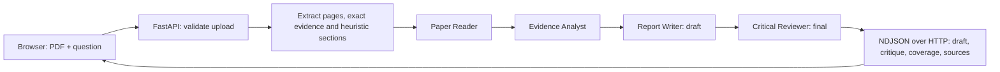

# Paper Research Team — Research Desk

[Open Research Desk](https://jeeth-researcher.vercel.app)

Upload one English research-paper PDF and ask a focused question. Four roles explain
its proposal, assess experimental evidence, write a draft and critically examine
both the paper and the draft. Exact source passages and a coverage ledger make the
reading inspectable. This is one-paper analysis, without external literature search
or claims of global novelty, scientific verification or improved accuracy.

The motivation came from Jeeth's ACL ARR submission: reassuring LLM feedback missed
ambiguities human reviewers later identified. That motivates a distinct critical
stage; it does not establish that this application reliably detects those issues.

## Run locally

Python 3.12; no frontend build step.

```sh
python3.12 -m venv .venv
source .venv/bin/activate
python -m pip install -r requirements.txt
[ -f .env ] || cp .env.example .env
# Edit .env locally: GROQ_API_KEY and GROQ_MODEL.
uvicorn app:app --reload --host 127.0.0.1 --port 8000
```

Open http://localhost:8000. `python app.py` launches the same FastAPI app without
reload. Windows activation: `.venv\Scripts\activate`. Environment variables override
`.env`; restart after changes. Credentials remain server-side, outside Git and logs.

## Architecture



LangGraph has exactly four sequential nodes. Earlier findings pass directly through
shared state. One Groq-hosted model performs every role. The reviewer runs last;
there is no correction loop, supervisor or automatic rewrite after review.

- **Reader:** plain-language problem, approach and contributions; receives distributed
  source passages across the detected regions.
- **Analyst:** examines datasets, baselines, metrics, conditions and reported results;
  its initial packet prioritizes methods/experiments/results.
- **Writer:** combines findings into an explanation draft; source tools remain available.
- **Reviewer:** receives the draft and earlier findings, revisits cited sources and
  other available passages, then reports concrete paper/report concerns, suggested
  clarifications and uncertainties. Report concerns identify the affected draft text.

FastAPI handles `UploadFile`/`Form` and readable errors. Uvicorn serves the ASGI app
locally. PDF extraction and the synchronous investigation iterator run in worker
threads. `StreamingResponse` returns one JSON object per line: NDJSON is a format
inside HTTP, not a replacement for HTTP or token streaming. Disconnect cleanup
cannot instantly cancel an in-flight synchronous provider call.

## Section-aware reading and honest coverage

`reading.py` recognizes standalone common headings, optionally numbered, such as
Introduction, Methods, Results and Limitations. At least two distinct recognized
headings are required; otherwise reading regions are physical pages. Contents-page
listings are ignored. This heuristic can misclassify headings and does not understand
layout, tables or figures.

The original evidence registry is unchanged: deterministic IDs, physical PDF pages,
exact text and character offsets in passages of at most 800 characters. A passage
crossing a heading can belong to two regions; IDs/text are never invented or rewritten.

Each role gets at most 24 outline previews of 80 characters. The reader's full-source
packet is distributed across regions; the analyst prioritizes experimental sections;
the reviewer revisits draft references and other available material. The configured
full-passage budget defaults to **4,800 characters per visit**, with 800 reserved for
tool retrieval. Tools share that same budget; whole passages are omitted rather
than silently shortened. Outlines/previews are separate from this body-text budget. Follow-up requests resend
the existing conversation; provider token counts include that repetition.

Only two model-callable tools exist: `search_paper(query)` (keyword overlap, up to
four bounded matches) and `get_evidence(evidence_id)` (one exact passage). No embeddings,
vector database or external search is used. Reader, analyst and reviewer must receive nonempty full source passages, through
their packet or a tool response. Previews and empty searches alone do not count.

Coverage distinguishes extraction, short previews, confirmed full-passage submission
and text not supplied to each role. Confirmation means the provider returned a
response, including a truncated one; a failed connection has unknown receipt.
Prompts prepared before a failed request are not claimed as received. The UI/export
show exact received IDs and omitted text counts. **Delivery is not understanding,
complete section review or semantic correctness.** Shared findings are context, not
new source inspection. Exact ID/page/offset validation prevents invented addresses,
but a real passage can still be irrelevant to a conclusion.

## Configuration and limits

| Variable | Default / bound |
| --- | --- |
| `GROQ_API_KEY` | Server-side credential |
| `GROQ_MODEL` | `openai/gpt-oss-20b`, shared by all roles |
| `GROQ_MAX_OUTPUT_TOKENS` | 2048; allowed 128–8192 per request |
| `MAX_SOURCE_CHARS_PER_ROLE` | 4800; allowed 1600–8000, full passages including tool additions |
| `MAX_UPLOAD_MB` | 4 MiB; capped at 4 for Vercel |
| `MAX_TEXT_CHARS` | 20,000; reject rather than truncate |
| `MAX_MODEL_REQUESTS_PER_VISIT` | 3; allowed 1–3 |
| `MAX_TOOL_CALLS_PER_VISIT` | 2; allowed 1–2 |
| `MAX_TOTAL_MODEL_REQUESTS` | 12; legacy settings up to 24 remain valid without adding visits |
| `PORT` | 8000 for `python app.py`; Uvicorn CLI uses `--port` |

Four visits permit **at most 12 model requests and 8 tool executions**. A successful path can finish in four requests with source packets alone; tools
add follow-up requests when the model chooses them. Every follow-up is
a request; a response with two tool requests executes two tools. Counters include
attempts, including failures. SDK retries are disabled. A cooperative 240-second
deadline starts after extraction; individual hosted calls are capped at 45 seconds.
Quota, provider, malformed-output and budget failures preserve available findings
and mark the run incomplete. A failed final reviewer leaves an explicitly unreviewed
draft. Free-plan quotas can interrupt runs; public users share the server allowance.

The upload endpoint reads at most the file limit plus one byte and checks actual
bytes. Multipart parsing can spool before that check; this is not a network-level
body limit. No OCR or language detection exists. Scanned, unreadable, encrypted or
oversized inputs are rejected; extracted columns/equations can still be imperfect.

## Evaluation: baseline versus workflow

[Evaluation instructions and annotation format](evaluation/README.md)

The target is **12 independently labelled real papers**. Currently **0 genuine real
cases are available and 0 real papers are scored**. Two original synthetic fixtures
test mechanics; they are not a real-paper benchmark. No ARR paper/comments were
available for this use. Missing inputs are exact permitted PDF/review versions,
independent issue labels, matching criteria and human adjudication.

The single-call baseline gets the **full accepted extraction**, the same model,
question, source hash and output criteria. The workflow uses bounded source packets
and tools. These input/call-budget differences are recorded, not attributed solely
to having multiple roles. Runs preserve prompts/settings, code/version identifiers,
outputs, source delivery, provider token counts when returned, and actual elapsed
seconds. Pytest duration is never presented as application latency.

```sh
python evaluate.py prepare-synthetic
python evaluate.py plan --cases artifacts/evaluation/cases.json --case-limit 1
# Explicit quota-consuming comparison: estimate is at most 13 requests for this pair.
python evaluate.py run --cases artifacts/evaluation/cases.json \
  --case-limit 1 --max-calls 13 --live --out artifacts/evaluation-runs
```

Scoring requires human annotations tied to run/finding fingerprints. It counts known
issue hits, misses, false alarms, duplicates, additional valid and unjudged findings.
An extra finding is not automatically false. Recall/missed counts require completed,
fully adjudicated arms; raw counts/denominators accompany percentages. There is no
LLM judge. Review opinions can be ambiguities, missing detail or subjective suggestions,
not unquestionable factual errors. No accuracy improvement is claimed.

## Files, testing and hosting

| File | Responsibility |
| --- | --- |
| `app.py`, `api/research.py` | FastAPI endpoints, upload validation, NDJSON stream; same ASGI app on Vercel |
| `pdf_reader.py`, `reading.py` | Physical pages/exact passages; section heuristics, packets and source-delivery ledger |
| `agents.py`, `tools.py` | Four prompts, structured validation, bounded tool loop and two dispatch entries |
| `workflow.py`, `llm.py` | Fixed LangGraph, deterministic export; one Groq helper, safe errors, token usage |
| `evaluate.py`, `evaluation/` | Reproducible comparison, case/version checks and human scoring |
| `public/` | Research Desk interface, safe text rendering, source inspection and Markdown download |

```sh
python -m pytest -q -rs
node --check public/app.js
node --check tests/frontend_contract.cjs
```

Session verification: **147 mocked tests passed; one local socket smoke test skipped**
because this execution environment denies binding. JavaScript syntax checks passed.
A local live synthetic comparison stopped after one connection failure in the baseline;
the workflow arm was not started. That is a partial smoke attempt, not an evaluation
result. Actual production checks and any live streamed run are recorded separately
in the completion handoff. No real-paper comparison score is available.

Tested Python 3.12.2; dependency versions are pinned in `requirements.txt`: pypdf,
LangGraph, official Groq SDK, FastAPI, Uvicorn, python-multipart, python-dotenv,
pytest and HTTPX. No new dependency is needed for reading/evaluation. LangGraph
orchestrates nodes; no LangChain model wrappers are used.

Vercel's existing `framework: null`, `public/` output and file-based ASGI entrypoint
are retained. Production uses its existing environment variables. The 4 MiB PDF cap
fits its documented 4.5 MB payload limit. Security headers and exclusions remain;
private notes, secrets, PDFs, generated runs and evaluation-only code are excluded
from deployment. The UI stores received results under tab `sessionStorage` v3;
refresh restores them without rerunning, and New investigation clears the current
record. There is no durable server job, authentication or per-user quota control.
Selected source text goes to Groq; prompt-injection resistance is not guaranteed.

Résumé description: **AI-assisted Python paper-review application with four fixed
LangGraph roles, section-aware source packets, an auditable evidence-delivery ledger,
and a reproducible single-model baseline evaluation with human adjudication.**
