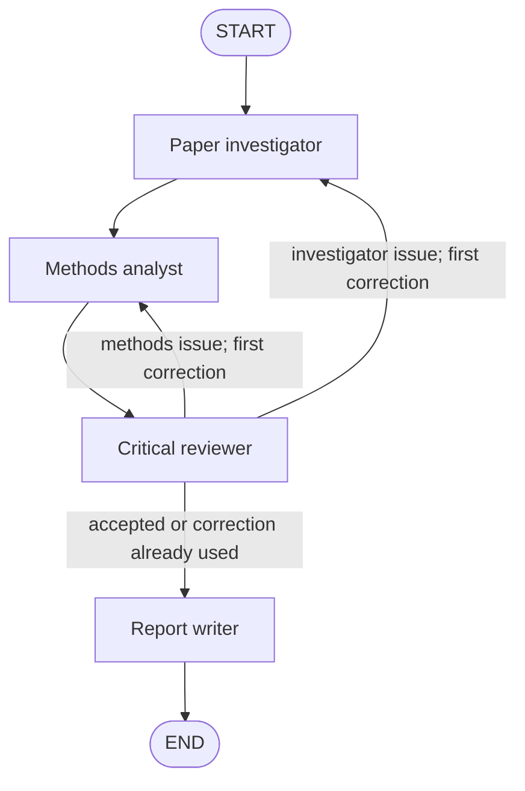

# Paper Research Team — Research Desk

**Live application:** https://research-team-rho.vercel.app

A small Python research-paper workflow with a custom, paper-inspired web interface.
Upload one English PDF, ask a question, and inspect contributions, experimental
claims, limitations, proposed follow-ups, reviewer concerns, and exact source
passages. Four roles share one Groq model. The app investigates only the uploaded
paper; it does not search other literature or establish global novelty.

## Run locally

Use Python **3.12**. No JavaScript build step or Node installation is needed.

```sh
python3.12 -m venv .venv
source .venv/bin/activate
python -m pip install -r requirements.txt
cp .env.example .env
# Edit .env locally and set your own free-plan GROQ_API_KEY.
python app.py
```

Open **http://localhost:8000**. On Windows, activate with
`.venv\Scripts\activate`. If your shell already contains a different Groq key,
remove that variable first: `unset GROQ_API_KEY GROQ_MODEL` on macOS/Linux.
Shell variables take precedence over `.env`. Restart the server after edits.
Never put a key in chat, Git, or client-side JavaScript.

```sh
python -m pytest -q
```

| Variable | Default / limit |
| --- | --- |
| `GROQ_API_KEY` | Required server-side credential |
| `GROQ_MODEL` | `openai/gpt-oss-20b`, one model for all roles |
| `GROQ_MAX_OUTPUT_TOKENS` | 2048; allowed 128–8192 |
| `MAX_UPLOAD_MB` | 4 MiB, capped at 4 for the hosted interface |
| `MAX_TEXT_CHARS` | 20,000 extracted characters |
| `MAX_MODEL_REQUESTS_PER_VISIT` | 3, configurable downward |
| `MAX_TOOL_CALLS_PER_VISIT` | 2, configurable downward |
| `MAX_TOTAL_MODEL_REQUESTS` | 24, configurable downward |
| `PORT` | 8000 for the local server |

Questions are limited to 2,000 characters. One correction cycle is allowed. A
240-second hosting deadline stops further requests; individual hosted model calls
use the remaining deadline, capped at 45 seconds. Partial findings survive failures.

## Workflow



`ResearchState` carries the question, physical PDF pages, evidence registry,
current findings, reviews, correction history, counters, operational events,
report, and deadline. Nodes update this shared dictionary; Python conditional
edges select the next node. There is no fifth LLM supervisor.

The correction counter increments before routing back. Investigator correction
replaces its findings and clears dependent methods findings; methods correction
replaces only methods findings. Old versions are archived. After the second
review, the writer always runs with the latest concerns. The final report keeps
unresolved issues and uncertainties even if the writer omits them. It receives
no further reviewer pass.

## Tools and function calling

| Tool | What it returns | Allowed roles |
| --- | --- | --- |
| `list_pages()` | First 40 page previews; explicit partial-list flag | Investigator |
| `search_paper(query)` | Up to four exact passages ranked by keyword overlap | Investigator, Methods |
| `read_page(page_number)` | First 4,000 characters, evidence and remaining IDs | Investigator, Methods, Reviewer |
| `get_evidence(evidence_id)` | One exact passage with its physical page/offsets | Methods, Reviewer, Writer |
| `check_quote(page_number, quote)` | Whitespace-normalized quote existence | Reviewer |
| `get_findings()` | Current findings, review, and correction count | Writer |

Python assigns evidence IDs to exact slices of at most 800 characters. Models
cannot register evidence. Long page reads are explicitly marked partial; the
registry retains all extracted text. Keyword search can miss paraphrases. Quote
checking collapses Unicode whitespace to single spaces and strips ends, preserving
case/punctuation. A quote's existence does not establish semantic support.

`run_agent` sends instructions, relevant state, and allowed function schemas. It
reads model-selected tool requests, validates names/arguments/IDs, executes the
ordinary Python functions, and sends results with matching `tool_call_id` values.
Each request and executed tool is counted. Invalid or over-budget batches are
rejected before execution. The last available request disables further tools.

Final JSON findings and review decisions have explicit local validation. Unknown
evidence, invalid pages, mismatched canonical citations, malformed fields, duplicate
JSON keys, and invalid correction decisions stop the run visibly. Groq's
[structured-output documentation](https://console.groq.com/docs/structured-outputs)
does not support strict structured outputs with tool use, so no `response_format`
is combined with the function-calling loop. Invalid JSON is never treated as approval.

## Files and technology choices

- `public/index.html`, `styles.css`, `app.js`: custom interface, source notes,
  accessible tabs, streamed progress, browser-tab storage, and Markdown download.
  Model/paper strings use `textContent`, not HTML insertion.
- `app.py`: standard-library WSGI application, bounded multipart upload parsing,
  settings, streamed graph execution, safe public snapshots, and local server.
- `api/research.py`: Vercel entrypoint importing that same application.
- `pdf_reader.py`: pypdf validation, physical page extraction, exact passages.
- `tools.py`: tool schemas, per-role allowlists, validation, and dispatch.
- `agents.py`: role prompts, structured-output validators, budgets, reusable loop.
- `workflow.py`: typed state, actual LangGraph, correction routing, report rendering.
- `llm.py`: official Groq SDK client/helper, safe errors, credential redaction.
- `tests/`: offline tests for PDFs, tools, graph routes, budgets, and HTTP boundary.

The selected Research Desk replaces the original Streamlit interface. The backend
remains Python with pypdf, LangGraph, Groq, python-dotenv, and the standard library;
pytest is used for tests. There is no React, FastAPI, database, embedding service,
vector store, external search, background job system, or additional agent framework.
LangGraph's supporting packages are installed transitively, without top-level
LangChain model wrappers. Direct source lookup is enough for one bounded paper.

## Limits, privacy, and free quotas

Checked **2026-11-05**: Groq documents [function calling for GPT-OSS 20B](https://console.groq.com/docs/model/openai/gpt-oss-20b)
and [free-plan limits](https://console.groq.com/docs/rate-limits) of 30 requests/minute,
1,000/day, 8,000 tokens/minute, and 200,000/day. Exact account limits may differ.
Use a Free-plan account without billing enabled. The app cannot enforce your
account tier. There are no automatic retries, provider switches, or paid upgrades.
Eight or more model requests can exhaust free token limits, even for short papers.
The longest graph path has seven visits, at most 21 requests, within the additional
24-request ceiling. Public visitors share the configured key's quota.

No OCR or language detection is provided. Empty, encrypted, damaged, apparently
scanned, or oversized PDFs are rejected. Columns, equations, tables, figures, and
mixed scanned pages can extract poorly. Inspect Extracted text before relying on
an answer. Oversized extraction is rejected rather than silently truncated.

Selected passages and the question go to Groq. The application processes uploads
in memory and has no persistent server-side document store. Results/extracted text
are retained in this browser tab's session storage; refreshing never restarts a
run, and New investigation clears that record. Shared state is per HTTP request,
not a server-global registry. Events show operations, not private model reasoning.
Keys are redacted in returned views and exports. Instructions inside papers/tool
results are untrusted, but prompting cannot guarantee injection resistance.
Agent agreement and valid references are not scientific verification.

## Hosting on Vercel

The project is named **research-team**. Use a free Hobby team. Vercel supports
[WSGI applications in file-based Python functions](https://vercel.com/docs/functions/runtimes/python/api-directory).
`vercel.json` serves `public/`, builds the Python endpoint, sets security headers,
and excludes secrets, private notes, tests, and local artifacts from the function
bundle. `.vercelignore` also excludes those files from upload.

Set `GROQ_API_KEY` as a server-side Production/Preview environment variable in
Vercel, plus `GROQ_MODEL=openai/gpt-oss-20b`. Other settings can be configured there.
Do not prefix secrets with client-exposed names. `.env` is only for local use.

Vercel's [function limits](https://vercel.com/docs/functions/limitations) include a
4.5 MB request ceiling and a 300-second Hobby execution maximum. The application
uses a 4 MiB PDF cap and a 240-second execution deadline, without adding storage
services. A platform interruption can still close a connection; the browser marks
an unfinished record incomplete and preserves findings already received.

For later deployments, after authenticating and linking the project:

```sh
vercel deploy --prod
```

The source repository is `jeeth-kataria/researchagent`. Private study notes remain
under `local-docs/` and are excluded using `.git/info/exclude` in the publishing
checkout, never shared ignore rules. No paid resources or billing upgrades are needed.

## Verification

Tested with Python **3.12.2** and the exact direct versions in `requirements.txt`:
pypdf 6.21.4, LangGraph 1.2.20, Groq 1.7.0, python-dotenv 1.2.4, pytest 9.2.0.

- **73 Python tests passed**, using mocked Groq responses and the actual graph.
- Desktop/mobile browser checks passed for upload feedback, streamed graph output,
  source and activity views, keyboard tabs, Markdown contents, and refresh persistence.
- Live Vercel checks passed for the desktop/mobile UI, Python configuration
  endpoint, security headers, secret-file exclusion, and invalid-PDF response.
- No live Groq inference was performed during this deployment.
- Browser checks use real graph output with mocked SDK responses; they do not
  establish live model quality, scientific correctness, or sustained free-tier capacity.
